<!-- The block between the press-room markers is redrawn by .github/workflows/press-room.yml. Edit everything else freely. -->
<!-- press-room:start -->

  <picture><source media="(prefers-color-scheme: dark)" srcset="./assets/press-room/press-room-dark.svg"></picture>

  <a href="https://llbartolome-portfolio.vercel.app/work?read=moneda"><picture><source media="(prefers-color-scheme: dark)" srcset="./assets/press-room/card-moneda-dark.svg"></picture></a>
  <a href="https://llbartolome-portfolio.vercel.app/work?read=realm-breaker"><picture><source media="(prefers-color-scheme: dark)" srcset="./assets/press-room/card-realm-breaker-dark.svg"></picture></a> 
  <a href="https://llbartolome-portfolio.vercel.app/work?read=aqualogic"><picture><source media="(prefers-color-scheme: dark)" srcset="./assets/press-room/card-aqualogic-dark.svg"></picture></a>
  <a href="https://llbartolome-portfolio.vercel.app/work?read=whisk"><picture><source media="(prefers-color-scheme: dark)" srcset="./assets/press-room/card-whisk-dark.svg"></picture></a> 
  <a href="https://llbartolome-portfolio.vercel.app/work?read=memorylane"><picture><source media="(prefers-color-scheme: dark)" srcset="./assets/press-room/card-memorylane-dark.svg"></picture></a>
  <a href="https://llbartolome-portfolio.vercel.app/"><picture><source media="(prefers-color-scheme: dark)" srcset="./assets/press-room/card-issue-dark.svg"></picture></a> 

<!-- press-room:end -->

<!-- The block between the back-matter markers is drawn from MASTHEAD, STACK, MOTTO and WIRE in press-room/render.mjs. -->
<!-- back-matter:start -->

  <picture><source media="(prefers-color-scheme: dark)" srcset="./assets/press-room/masthead-dark.svg"></picture>

  <a href="https://llbartolome-portfolio.vercel.app/"><picture><source media="(prefers-color-scheme: dark)" srcset="./assets/press-room/wire-portfolio-dark.svg"></picture></a>
  <a href="https://www.linkedin.com/in/lord-bartolome-49153242b/"><picture><source media="(prefers-color-scheme: dark)" srcset="./assets/press-room/wire-linkedin-dark.svg"></picture></a>
  <a href="mailto:bartolomell0705@gmail.com"><picture><source media="(prefers-color-scheme: dark)" srcset="./assets/press-room/wire-email-dark.svg"></picture></a>

<!-- back-matter:end -->
